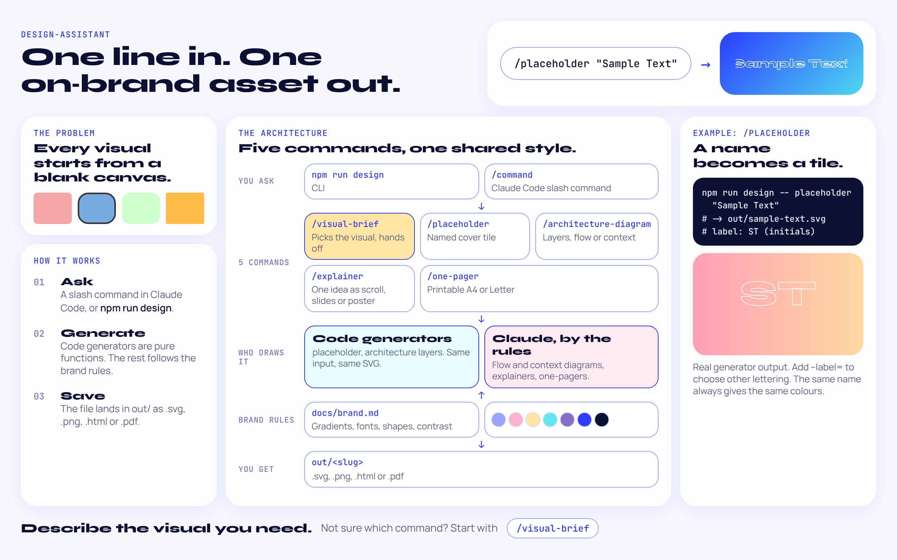
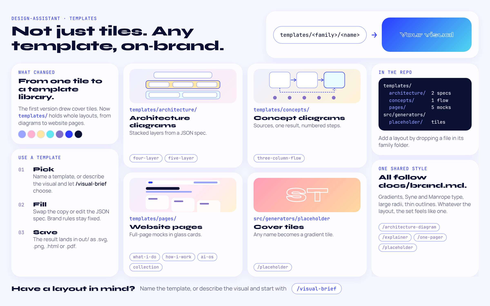

# design-assistant

My personal design assistant. It generates visual assets from the command line or from Claude Code.

## What it does
One line in, one on-brand asset out. Five commands share one set of brand rules (`docs/brand.md`): code generators draw the repeatable shapes, and Claude draws the rest to the same rules.

[](docs/design-assistant-explainer.html)

Open [`docs/design-assistant-explainer.html`](docs/design-assistant-explainer.html) in a browser for the full page.

## Generators

### placeholder
A gradient card with the name's initials or acronym drawn as thin outlined lettering (Syne ExtraBold),
originally built for portfolio case-study tiles that have no preview image yet.
The same name always yields the same colours.

```
npm install
npm run design -- placeholder "Visa: The future of brand"          # out/visa-the-future-of-brand.svg
npm run design -- placeholder "My AI operating system" os.png --label=OS
```
In Claude Code: `/placeholder "Visa: The future of brand"`.

The label comes from the name: a short prefix before a colon (`ASICS: ...` gives ASICS), else a leading acronym (`ML ...` gives ML),
else the initials of the first two main words. `--label` overrides it. PNG output needs `npx playwright install chromium`.

### architecture
A layered architecture diagram from a small JSON spec, in the portfolio's colours (light, with the site gradient, or dark).
Text is drawn as paths from Manrope and Syne outlines, so the SVG works as an `` anywhere.

```
npm run design -- architecture four-layer-structural                       # out/four-layer-structural-light.svg
npm run design -- architecture my-spec.json diagram.png --theme=dark
```
In Claude Code: `/architecture-diagram "<system>"` or `/architecture-diagram five-layer-stack --theme=dark`. The command uses this generator for stacked layers and draws flow and context diagrams by hand. Spec shape and examples: `templates/architecture/`.
After changing fonts, run `npm run build:fonts` to regenerate `src/generators/architecture/fontdata.ts`.

## Templates
Beyond tiles, the tool starts from a library of templates: `templates/architecture/` (JSON specs for layered diagrams), `templates/concepts/` (concept-diagram layouts) and `templates/pages/` (full website page mocks and the Collection page style sheet, as standalone HTML).



## Ideas
See `ROADMAP.md` for the commands and skills to add next.

## Adding a generator
See `AGENTS.md`.

## Reference templates
`templates/concepts/three-column-flow.html` is a generic conceptual-diagram layout (two sources, one combined result, a loop line and a numbered setup row). Copy it and replace the `[BRACKETED]` text to make an explainer, one-pager hero or concept diagram.
