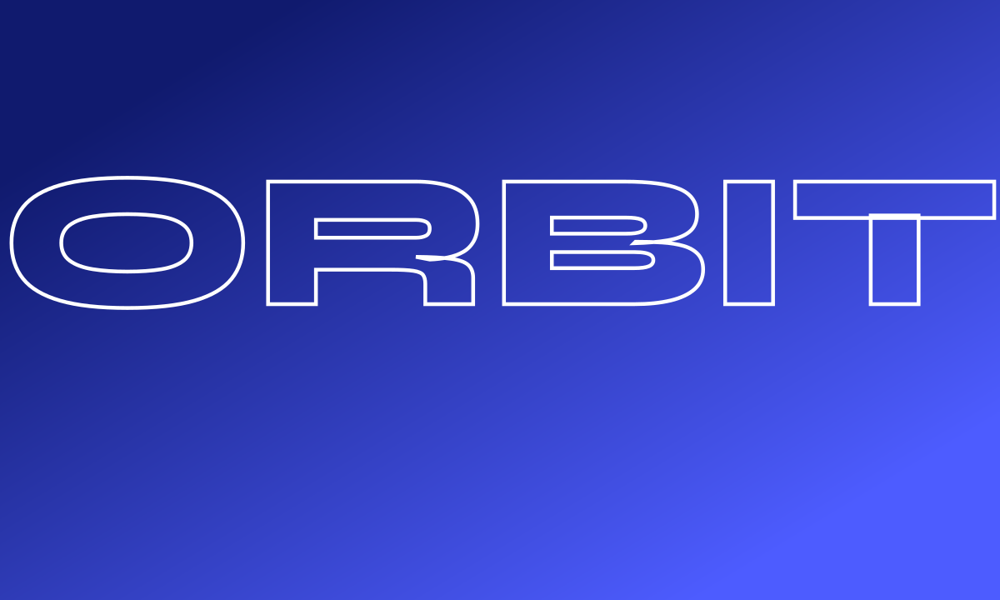
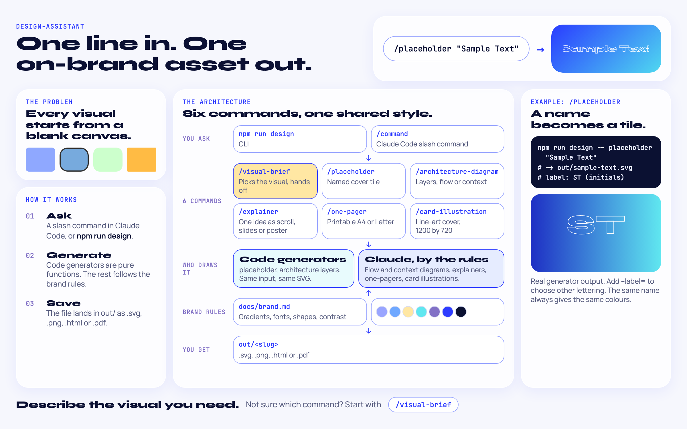
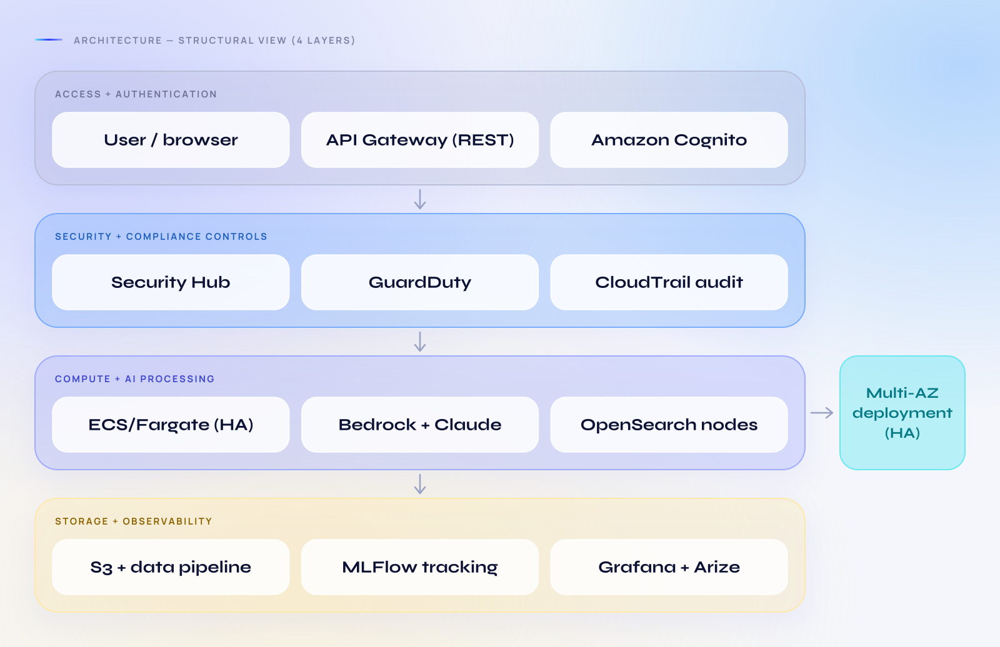

# design-assistant

My personal design assistant. It generates visual assets from the command line or from Claude Code.

## Problem
Case-study tiles and diagrams need on-brand visuals before a real preview image exists, and hand-made ones drift from the brand.

## Try it
```
npm install
npm run design -- placeholder "Orbit: Field service platform"   # writes out/orbit-field-service-platform.svg
```
Open the SVG in a browser to see the result. That command produces this card:



## Decision
Generators write dependency-free SVG with text drawn as outlines from the brand fonts, so each asset works as an `` anywhere and the same name always produces the same colours. Claude draws the shapes the generators can't, to the same brand rules.

## What it does
One line in, one on-brand asset out. Six commands share one set of brand rules (`docs/brand.md`): code generators draw the repeatable shapes, and Claude draws the rest to the same rules.

[](docs/design-assistant-explainer.html)

Open [`docs/design-assistant-explainer.html`](docs/design-assistant-explainer.html) in a browser for the full page.

## Design system
The same style is the Design System **AH Visuals** in Claude, for decks, designs and pages made there. Its source is `design-system/`; how it is published and kept in step: `docs/design-system.md`. It covers everything outside annahovhannisyan.com, which has its own design system in the Portfolio repo.

## Generators

### placeholder
A gradient card with the name's initials or acronym drawn as thin outlined lettering (Syne ExtraBold),
originally built for case-study tiles that have no preview image yet.
The same name always yields the same colours.

```
npm install
npm run design -- placeholder "Orbit: Field service platform"      # out/orbit-field-service-platform.svg
npm run design -- placeholder "My AI operating system" os.png --label=OS
```
In Claude Code: `/placeholder "Orbit: Field service platform"`.

The label comes from the name: a short prefix before a colon (`Atlas: ...` gives ATLAS), else a leading acronym (`ML ...` gives ML),
else the initials of the first two main words. `--label` overrides it. PNG output needs `npx playwright install chromium`.

### architecture
A layered architecture diagram from a small JSON spec, in the brand's named colours (light, or dark / navy / cobalt blue backgrounds).
Text is drawn as paths from Manrope and Syne outlines, so the SVG works as an `` anywhere.

```
npm run design -- architecture four-layer-structural                       # out/four-layer-structural-light.svg
npm run design -- architecture my-spec.json diagram.png --theme=navy
```

`four-layer-structural` in the light theme:


In Claude Code: `/architecture-diagram "<system>"` or `/architecture-diagram five-layer-stack --theme=navy`. The command uses this generator for stacked layers and draws flow and context diagrams by hand. Spec shape and examples: `templates/architecture/`.
After changing fonts, run `npm run build:fonts` to regenerate `src/generators/architecture/fontdata.ts`.

### card-illustration
Claude draws a 1200x720 SVG cover for a project card, an article or a post: white line art on a brand gradient, or a recolour of existing art into the brand palette.
The command keeps the subject inside the part of the card that stays visible (above the glass text panel, clear of the corner badges, inside the phone crop).
In Claude Code: `/card-illustration "GTM Engine: one shared AI skill library for GTM teams"` or `/card-illustration "Company Brain" --style=recolor --source=old.svg`. Examples: `templates/thumbnail-illustrations/`.

## Templates
`templates/architecture/` holds architecture specs. `templates/blue-backgrounds/` holds the hero slide template (1920x1080) with its six grounds, light (the primary one) and five dark blues, and a PNG preview of each.

## Ideas
See `ROADMAP.md` for the commands and skills to add next.

## Adding a generator
See `AGENTS.md`.

## Reference templates
`templates/one-pager/comparison.html` is an A4 one-pager comparing two things: a row-by-row table, what each side holds with counts, the key number, why both are needed and what they share. Copy it and replace the `[BRACKETED]` text, or run `/one-pager` with `--type=comparison`.
`templates/mermaid/` holds generic Mermaid sources: `layered-system-map.mmd` (inputs, engine, outputs and promotion layers) and `dependency-chain.mmd` (a "depends on" chain row). Render with `npx -p @mermaid-js/mermaid-cli mmdc -i <file>.mmd -o out/<name>.svg`.

## Example names and trademarks

All names used in this repository's examples, templates, tests and documentation, such as "Orbit: Field service platform" and "Atlas", are fictitious and are used only to illustrate how the tools work. Any resemblance to an actual company, organization, product, project or person is purely coincidental, and nothing here implies any affiliation with, or sponsorship or endorsement by, any of them.

Claude Code, Google Fonts, Playwright, Mermaid and the other third-party products named in this repository are trademarks of their respective owners. They are named only to describe how this tool works with them.

## License

MIT. See [LICENSE](LICENSE).
